# Revisão UI/UX — 0.1.1

Revisão crítica independente pelo subagente Schrodinger, seguida de implementação e conferência pontual. A interface permanece GTK4 nativa e usa o tema do sistema. Prioridades: organização por tarefa, ações junto de seu alvo, alternativas ao arrasto, preservação dos dados e recuperação de erros.

| Problema identificado | Correção |
|---|---|
| Endpoint ONVIF não persistia ao salvar sem consultar | Coletor valida/salva explicitamente e invalida perfis, capacidades e autorização ao mudar dispositivo |
| Botões + e biblioteca aceitavam somente arrasto | Seletor de câmera por clique/ativação de teclado e inserção pela lista; DnD preservado |
| Nome da View ilegível em janela pequena | Nome em linha própria; controles de grade agrupados abaixo |
| URL, endereço e porta competiam como fontes da conexão | URL completa define host/porta e destino informativo |
| Cadastro plano com opções avançadas antes das credenciais | Abas Conexão, ONVIF e Avançado; seções e rolagem própria |
| Feedback fora da área visível ou atrás de modal | Rodapé fixo no cadastro; erro local no diálogo do painel; foco no campo inválido |
| Preset substituía painéis e câmeras | Reflow preserva identidade/câmera/proporção, rejeita perda e oferece até 20 passos de desfazer; preencher é explícito |
| Estado vazio sem ação e comandos sem alvo habilitados | Adicionar câmera/Criar View/Escolher câmeras e Editar View desabilitado sem seleção |
| Foco dependia de duplo clique e retorno não era visível | Enter, menu Ampliar câmera e botão Voltar à grade; Escape preservado |
| PTZ dependia de gestos do mouse | Ativação padrão de botão gera pulso limitado com Stop; atalhos de diagonais/zoom; campos preservam teclas de edição |
| Rótulos sem associação acessível explícita | Relação rótulo/controle e nomes acessíveis GTK nos comandos |
| Ações de View distantes, inicial sem indicador e sidebar ocupava janela pequena | Menu por linha, badges Favorita/Inicial, ordenação transacional e recolhimento adaptativo |

A segunda revisão encontrou três regressões, também corrigidas: consulta ONVIF reabilita o seletor e permite escolher outro perfil; favoritar outra View preserva seleção e reprodução; duplicação limpa foco e renderização descarta referência a painel removido.

## Evidência

- 14 testes padrão de core/storage/media/ONVIF passaram, além da regressão GTK ampliada no Xvfb; fmt, Clippy com warnings negados e build release passaram.
- GTK real: endpoint salvo sem consulta/invalidação; mock ONVIF com dois perfis selecionáveis e URLs distintas; inserção por lista/+ e drop; preset/undo e cancelamento; erro de sobreposição local; Enter/menu/retorno/Escape; sidebar pequena/grande; favoritos de outra View, duplicação em foco, ordenação e exclusão da inicial; movimento/Stop PTZ e liberação do estado.
- AppImage 0.1.1 gerado e smoke por extração/Xvfb com banco temporário passou; checksum conferido. A conferência pontual final do revisor não encontrou novos problemas nos três ajustes adicionais.
- Capturas de monitor, cadastro, editor e erro local inspecionadas. Exemplos pequenos abaixo; vídeo é uma fixture sintética, sem câmeras ou credenciais privadas.

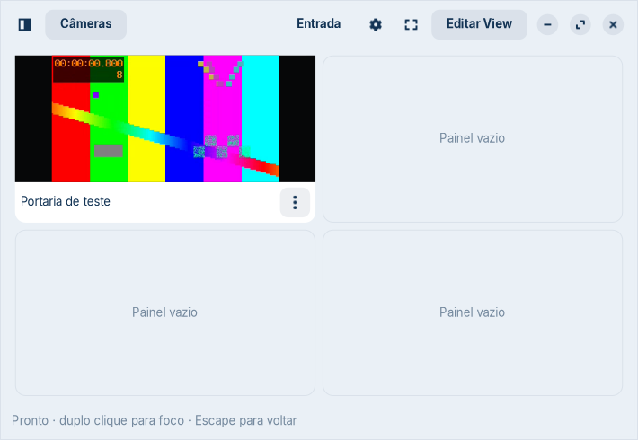

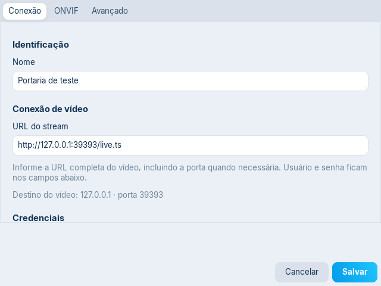

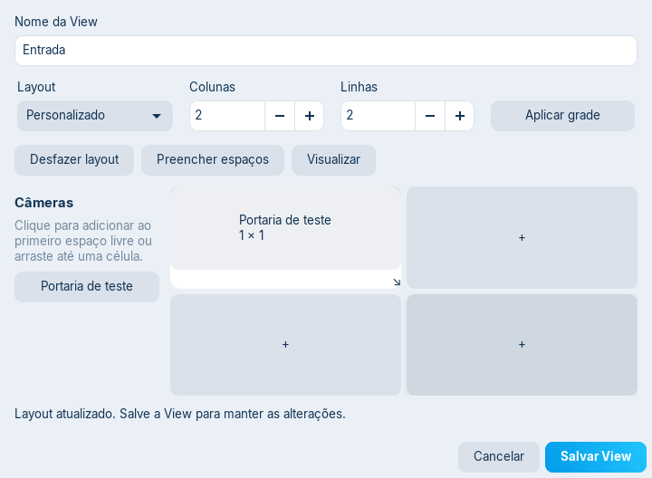

Capturas mostram widgets no tema instalado; não substituem testes humanos. Leitor de tela/Orca, arrasto físico, Wayland/HiDPI, motor PTZ, VA-API e câmeras reais continuam NOT VERIFIED. Ver TESTING.md e FEATURES.md para reprodução e limites. AppImage e checksum ficam em dist/; somente commits locais.

## Ajustes solicitados — 0.1.2

- Rodapé: a área vazia de feedback foi removida do cálculo de altura; Cancelar/Salvar ficam junto das abas. A regressão GTK mede o intervalo e confirma erro de timeout visível sem fechar o formulário.
- Tela principal: removido o texto permanente “Pronto”. A área de status fica oculta sem erros reais.
- Conexões: seletor RTSP/HTTP(S)/MJPEG/JPEG com opções avançadas e instruções específicas. Persistência e validação por tipo, demuxers explícitos para MJPEG e renovação periódica de JPEG no player nativo; cadastros antigos mantêm Auto.
- Views: linhas com altura uniforme, subtítulos reservados e menus centralizados; sem rolagem horizontal, nomes longos truncados e fundo do tema nativo.
- Evidência: 17 testes padrão, incluindo formatos MJPEG, intervalo/cancelamento JPEG e JSON legado; regressão GTK com seleção/opções, persistência, rodapé normal/erro e linhas uniformes. Capturas inspecionadas. Hardware e tecnologias assistivas seguem os limites de FEATURES.md.

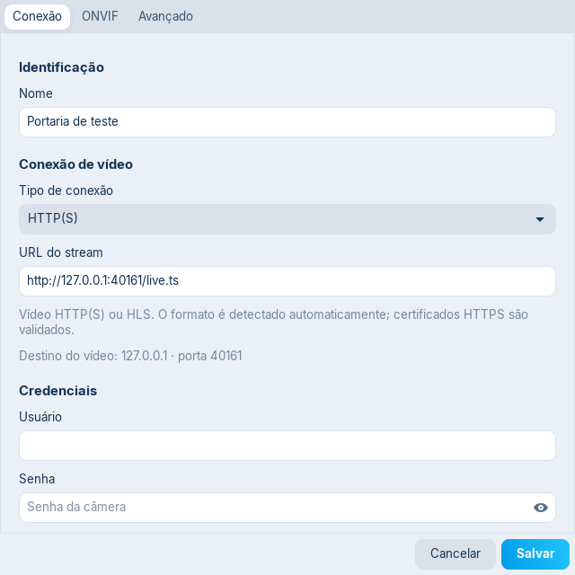

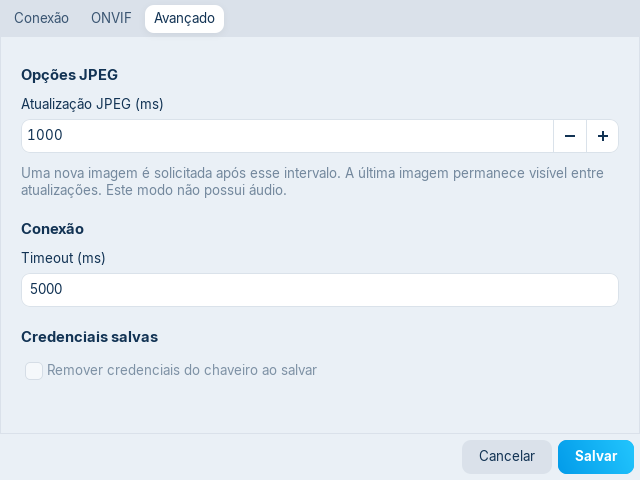

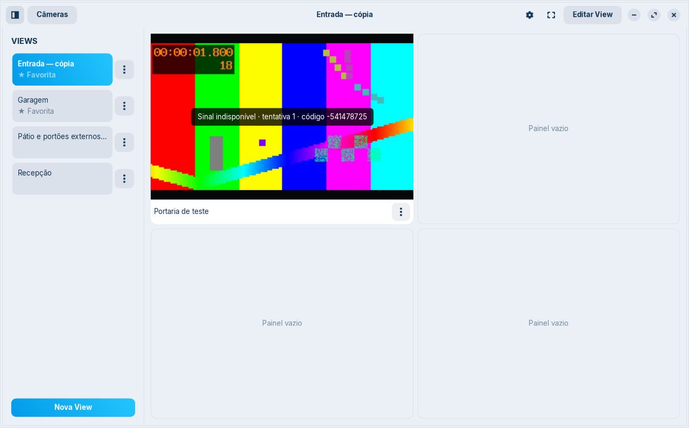

Pacote 0.1.2: checks, matriz de protocolos e smoke de inicialização/encerramento do AppImage passaram; checksum conferido. Sem push.

## Correção da regressão da lista — 0.1.3

A captura do usuário revelou que a reserva de subtítulo e a altura de 60 px da versão 0.1.2 tornaram um item simples excessivamente alto. Esse tratamento foi removido. Agora há uma única ListBoxRow nativa selecionável com nome, indicadores opcionais e menu sem moldura; favorita/inicial não criam linha extra. Ativar uma View preserva o foco no item. A seleção abrange também a área do menu, sem botão colorido separado.

A regressão GTK cobre uma View simples, várias Views, nome longo, favorita, seleção e ativação da segunda linha com foco preservado; confere altura uniforme de até 48 px. Capturas em temas claro e escuro inspecionadas. Isso substitui a proposta visual anterior para a lista; não muda os modelos ou serviços de reprodução.

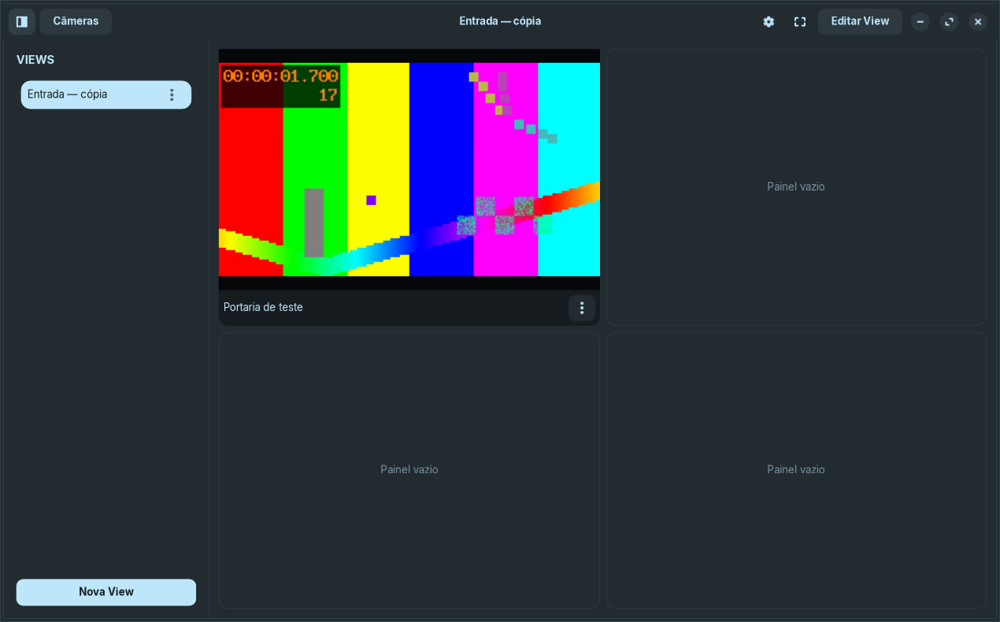

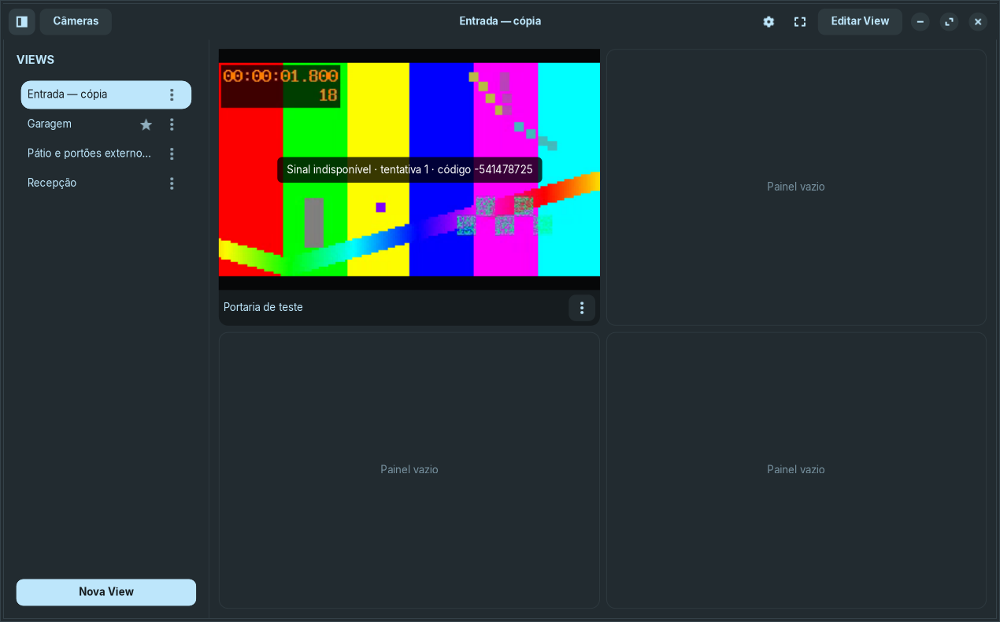

## Acesso público e certificado — 0.1.4

Conexão inclui Sem credenciais: campos privados ficam ocultos/desabilitados e os fluxos de reprodução, teste, consulta e PTZ ignoram o chaveiro. A referência ao segredo é preservada para reativação; remover continua uma ação explícita. Avançado inclui Segurança HTTPS com Validar certificado HTTPS, marcado por padrão e configurável por câmera. A flag é aplicada tanto no libav quanto no cliente ONVIF/PTZ.

GTK verifica alternância dos controles, flags salvas e uso público com referências fictícias de chaveiro sem consulta a Secret Service. O teste nativo de desafio HTTP garante que o modo anônimo não envia Authorization mesmo recebendo Credentials; o controle autenticado usa as mesmas credenciais com sucesso. HTTPS autoassinado TS/HLS/JPEG e SOAP são aceitos apenas com a exceção explícita; configurações padrão continuam recusando. Checks, 18 testes padrão, regressão GTK e smoke do AppImage 0.1.4 passaram.

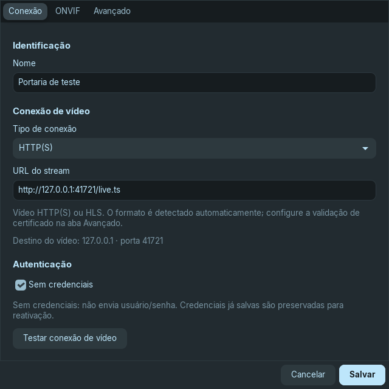

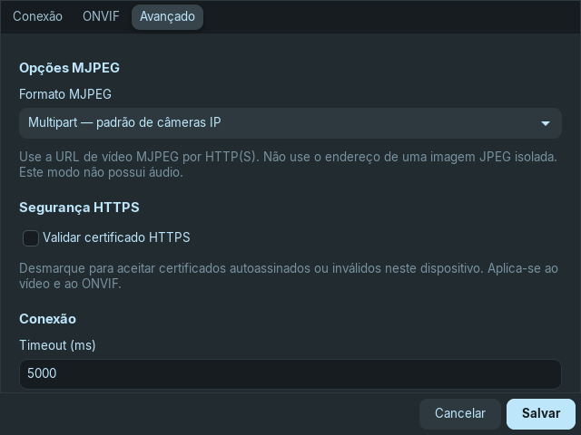

## Dashboard, apresentação, CLI e senha — 0.2.0

Duplo clique agora entra/sai de foco. A faixa extra foi removida; um X quadrado flutuante retorna à grade sem deslocar a sidebar ou o vídeo. F11 oculta cabeçalho, lateral e barras das câmeras e expande a área ocupada pelos painéis, preservando geometria relativa. F11/Escape retorna. O clipping arredondado se aplica também à textura decodificada.

O editor usa grade 12×12 com bordas/fundo contrastantes para painéis preenchidos. Arrastar numa região vazia desenha um painel; o seletor associa câmera. Largura/altura iniciais, layouts proporcionais, DnD, alça de resize, propriedades numéricas, undo e cancelamento funcionam sobre o mesmo modelo validado. Views antigas são convertidas no rascunho; se não couberem sem colisão, permanecem na grade original com feedback, sem sobrescrever dados.

Senha do aplicativo em Preferências permite definir/alterar/remover, com senha atual obrigatória nas duas últimas ações. Bloquear agora encerra sessões e mostra o gate. Startup só constrói reprodução após desbloqueio. A CLI abre View/fullscreen/biblioteca e lista metadados sem display, com proteção da biblioteca e desbloqueio por stdin. O bloqueio não criptografa arquivos; ver SECURITY.md.

Evidências: 22 testes padrão, GTK escuro com desenho 4×3, resize 5×4, colisão/undo/cancelamento, foco alternável, modo somente streams e senha incorreta/correta. AppImage 0.2.0: help/version headless, listagem protegida, stdin correto/incorreto e GUI com View/fullscreen, encerramento e checksum passaram. Auditoria RustSec da base local: zero vulnerabilidades/avisos. Compositor real, arrasto humano/Wayland/HiDPI e hardware permanecem nos limites de FEATURES.md.

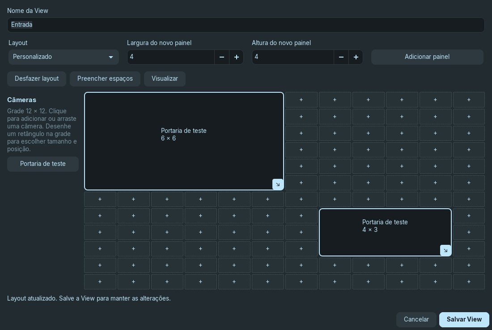

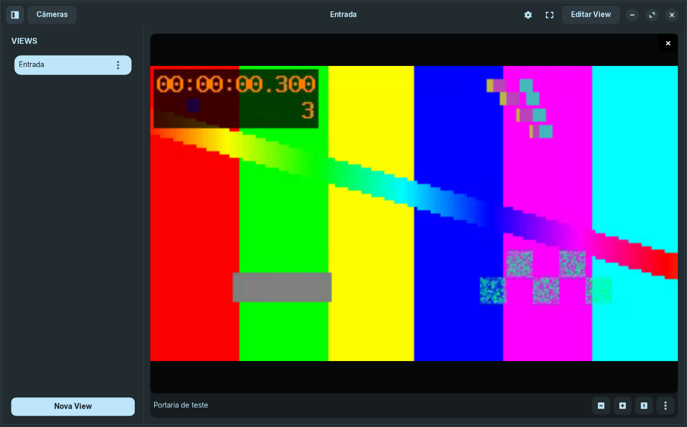

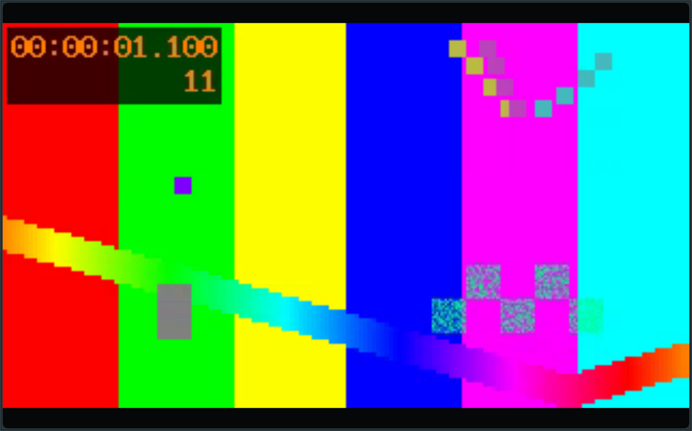

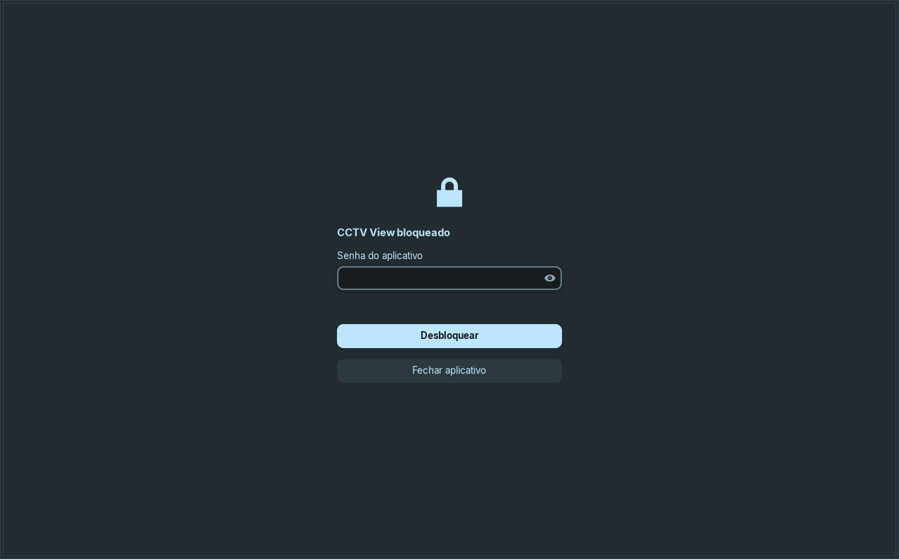

## Biblioteca e preferências — 0.3.0
Revisão de organização aplicada à biblioteca: metadados em duas linhas, tipo e ações em posições consistentes, busca e pastas em barras separadas. Preferências usa três abas temáticas. Revisão crítica independente (Einstein, somente leitura) encontrou seleção perdida ao renomear, movimento sem transação, cancelamento enganoso durante importação e possibilidade de segredos no caminho de URL. Correções: selecionar nome novo, transação IMMEDIATE, bloquear cancelamento após iniciar e sincronizar estado mesmo sem janela; revisão editável de URLs antes de exportar e clone como rascunho revisável.

Capturas finais inspecionadas: [biblioteca escura](screenshots/camera-library-dark.png), [biblioteca clara](screenshots/camera-library-light.png), [pasta renomeada](screenshots/camera-folder.png), [geral](screenshots/settings-general.png), [transferência](screenshots/settings-library.png), [segurança](screenshots/settings-security.png), [revisão de URLs](screenshots/camera-export-review.png) e [prévia de importação](screenshots/camera-import-preview.png). GTK valida linhas de mesma altura com nomes longos e tipos diferentes, cancelar rascunho sem criar cópia, filtro preservado e cancelamento da prévia sem gravar. Sem Gtk-WARNING/CRITICAL/panic nos dois temas. O teste aguarda a janela de pasta receber foco antes de enviar a resposta, evitando corrida artificial do GTKText. Mensagens vazias não reservam altura no rodapé. Leitor de tela/Wayland/HiDPI e seleção de arquivo por interação física continuam NOT VERIFIED.

## Credenciais e criptografia — 0.4.0
A revisão obrigatória de URLs e o rascunho de clone de 0.3.0 foram retirados por solicitação explícita do usuário. O fluxo fica com duas proteções: diálogo de senha do aplicativo para acessar dados/clonar/exportar quando configurada e senha escolhida para o arquivo criptografado. URLs/configurações/credenciais são preservadas; clone usa nova referência de segredo. A senha salva pode ser visualizada no campo nativo de edição depois da autorização. Validado no GTK claro/escuro com Secret Service descartável: prompts de senha incorreta/correta/cancelada, nova autorização em cada ação e cadastro de lista antiga, leitura de senha salva, clone completo, senha de arquivo errada/correta e restauração. Sem Gtk-WARNING/CRITICAL/panic. Capturas: [senha da exportação](screenshots/export-password.png), [tema claro](screenshots/export-password-light.png), [confirmar acesso](screenshots/camera-action-password.png), [configurações](screenshots/settings-encrypted-library.png) e [importação](screenshots/encrypted-import-preview.png). Revisão crítica estática de Cicero orientou a leitura única da configuração na clonagem, coberta por teste com alteração concorrente. Hardware/Wayland/HiDPI/Orca e interação física com seletor de arquivo continuam NOT VERIFIED.
